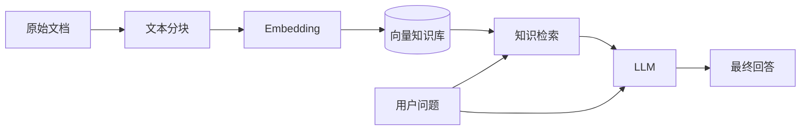
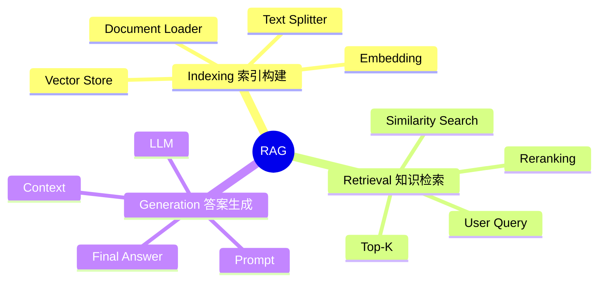
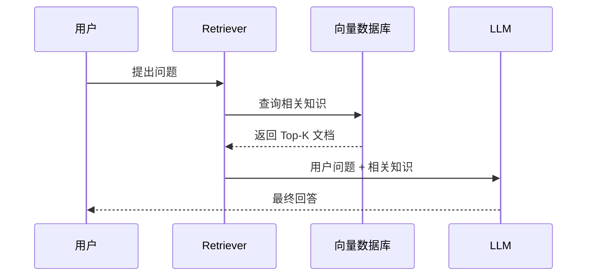

# RAG 可视化兼容性测试

明白了，你是想测试不同的**可视化技术和渲染格式**，而不是不同风格的 AI 生成图片。

下面统一使用 RAG 作为测试内容，你可以直接复制到思源笔记和语雀中，看看哪种格式能够正常显示。

## **方案一：ChatGPT 原生可视化**

**Documents**

原始文档

**Indexing · 索引构建**

文档加载、分块、向量化

**Retrieval · 知识检索**

根据用户问题查找相关知识

**Generation · 答案生成**

结合知识与用户问题生成答案

**Final Answer · 最终回答**

## **方案二：SVG 矢量架构图**

> 根据本回答的 RAG 内容补绘。

![RAG 索引、检索与生成]()

## **方案三：Mermaid 流程图（Flowchart）**

> 根据复制文本中的标签重建，连线和层级按 RAG 流程补全。



## **方案四：Mermaid 思维导图（Mindmap）**

> 根据复制文本中的标签重建，连线和层级按 RAG 流程补全。



## **方案五：原生 SVG 思维导图**

> 根据本回答的 RAG 内容补绘。

![RAG 三个阶段的知识结构]()

## **方案六：Mermaid 时序图（Sequence Diagram）**

> 根据复制文本中的标签重建，连线和层级按 RAG 流程补全。



## **方案七：Graphviz 架构图**


这是一段 Graphviz 源码，在支持 Graphviz 的编辑器中才能渲染为图形。

## **方案八：PlantUML 架构图**


## **方案九：Unicode 字符思维导图**

```
RAG（检索增强生成）
│
├── 01. Indexing（索引构建）
│   ├── Document Loader
│   ├── Text Splitter
│   ├── Embedding
│   └── Vector Store
│
├── 02. Retrieval（知识检索）
│   ├── User Query
│   ├── Similarity Search
│   ├── Hybrid Search
│   └── Reranking
│
└── 03. Generation（答案生成）
    ├── Context Engineering
    ├── LLM
    ├── Answer Validation
    └── Final Answer
```

## **方案十：Unicode 字符流程图**

```
        ┌─────────────────┐
        │    Documents    │
        └────────┬────────┘
                 ↓
        ┌─────────────────┐
        │    Indexing     │
        └────────┬────────┘
                 ↓
        ┌─────────────────┐
        │  Vector Store   │
        └────────┬────────┘
                 │
User Query ─────→│
                 ↓
        ┌─────────────────┐
        │    Retrieval    │
        └────────┬────────┘
                 ↓
        ┌─────────────────┐
        │     Context     │
        └────────┬────────┘
                 ↓
        ┌─────────────────┐
        │       LLM       │
        └────────┬────────┘
                 ↓
        ┌─────────────────┐
        │  Final Answer   │
        └─────────────────┘
```

## **方案十一：Markdown 表格可视化**

| ① Indexing | ② Retrieval | ③ Generation |
| ---------- | ----------- | ------------ |
| 原始文档       | 用户问题        | 系统提示词        |
| ↓          | ↓           | ↓            |
| 文本分块       | 向量化         | 上下文组织        |
| ↓          | ↓           | ↓            |
| Embedding  | 相似度检索       | LLM          |
| ↓          | ↓           | ↓            |
| 向量知识库      | 相关知识        | 最终回答         |

## **方案十二：交互式动态可视化**

> 以下为复制时保留下来的静态内容。

## **RAG 工作流程演示**

Indexing · Retrieval · Generation

**用户问题：什么是 RAG？**

Similarity Search

RAG 技术原理

0.98

向量检索机制

0.86

LangChain 开发指南

0.72

模拟检索相关性分数点击顶部三个阶段，切换不同的数据处理流程。

## **兼容性测试记录**

你可以在两个笔记软件中分别测试，并在下面记录结果。

| 可视化方案             | 思源 | 语雀 |
| ----------------- | -- | -- |
| 1. ChatGPT 原生可视化  |    |    |
| 2. SVG 架构图        |    |    |
| 3. Mermaid 流程图    |    |    |
| 4. Mermaid 思维导图   |    |    |
| 5. SVG 思维导图       |    |    |
| 6. Mermaid 时序图    |    |    |
| 7. Graphviz       |    |    |
| 8. PlantUML       |    |    |
| 9. Unicode 思维导图   |    |    |
| 10. Unicode 流程图   |    |    |
| 11. Markdown 表格   |    |    |
| 12. 交互式可视化        |    |    |
| 13. PNG 图片（上一条回复） |    |    |

能够正常复制并显示的方案打勾，未勾选表示尚未确认支持。提交兼容性测试结果

以上共提供了 12 种不同的可视化示例，加上之前生成的 PNG 图片，共 13 项测试内容。Graphviz、PlantUML 等源码需要相应的渲染引擎，目前还没有在你的笔记软件环境中实际验证。

你可以先测试整篇复制，再测试单独复制图表，最终选择**兼顾美观、易读和笔记兼容性**的方案。